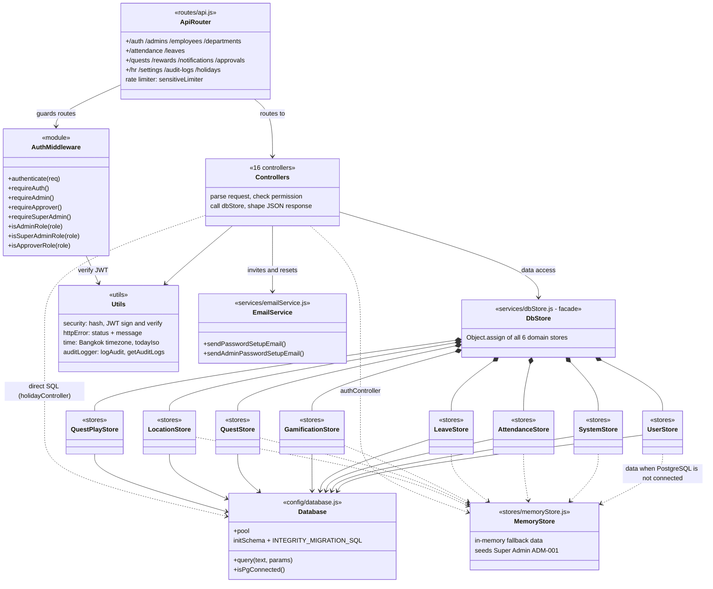
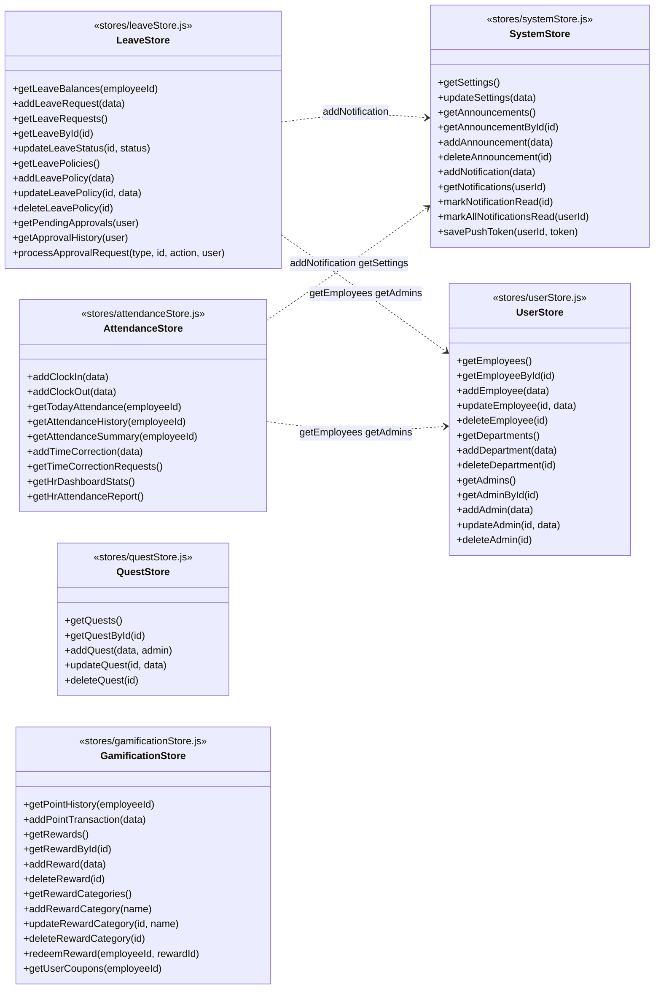
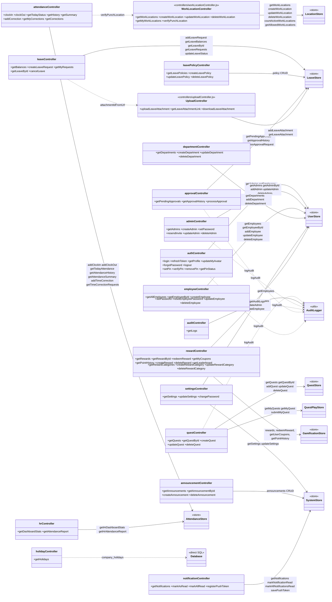

# WellX989 — Backend Class Diagram

Source: `backend/src/` (Node + Express). The backend is written with plain modules and factory functions, not ES classes,
so each box below is a **module** (`<<module>>`) and its public functions are shown as methods. Generated from the real code
on 2026-10-20; update it when you add or rename controllers, stores or routes.

**Legend:** `-->` uses / calls · `..>` optional or fallback use · `*--` composed into (the facade merges stores)

## สรุป: Class Diagram คืออะไร

**Class Diagram** คือแผนผัง "โค้ด backend" บอกว่าโมดูลไหนทำหน้าที่อะไร และเรียกใช้กันอย่างไร ใช้ตอนจะเพิ่ม API ใหม่
หาว่าจะแก้โค้ดที่ไหน หรือตามดูว่าคำขอหนึ่งๆ ไหลผ่านอะไรบ้าง (backend ไม่ได้เขียนเป็น class จริง จึงวาดแต่ละโมดูลเป็นกล่อง)

คำขอจากเว็บหรือแอปไหลผ่าน 5 ชั้น:

| ชั้น | ทำหน้าที่ | ตัวอย่าง |
|---|---|---|
| 1. Router | รับ URL แล้วส่งต่อให้ controller | `routes/api.js` |
| 2. Middleware | ตรวจ JWT และสิทธิ์ (`requireAuth`, `requireAdmin`, `requireApprover`, `requireSuperAdmin`) | `authMiddleware.js` |
| 3. Controller (17 ตัว) | รับคำขอ ตรวจข้อมูล เรียก store แล้วตอบ JSON | `leaveController`, `attendanceController` ฯลฯ |
| 4. `dbStore` | ตัวกลางที่รวม store ทั้งหมดไว้เป็นอันเดียว controller เรียกผ่านตัวนี้ตัวเดียว | `services/dbStore.js` |
| 5. Store (5 ตัว) | เขียน SQL ต่อ PostgreSQL (ถ้าต่อไม่ได้ใช้ `memoryStore` แทน) | ดูตารางด้านล่าง |

Store ทั้ง 6 ตัวแบ่งตามเรื่อง:

| Store | ดูแลเรื่อง |
|---|---|
| `userStore` | พนักงาน แผนก แอดมิน |
| `systemStore` | ค่าตั้งระบบ ประกาศ การแจ้งเตือน |
| `attendanceStore` | ลงเวลา แก้เวลา รายงาน HR |
| `leaveStore` | ลา นโยบายลา และการอนุมัติ |
| `gamificationStore` | ของรางวัล แต้ม คูปอง |
| `questStore` | Quest (quiz builder) คำถาม ผู้รับ และความคืบหน้า |
| `locationStore` | สถานที่ทำงานที่ลงเวลาได้ และสิทธิ์ใช้งานตามแผนก/รายบุคคล |

โมดูลช่วยที่หลายตัวใช้ร่วมกัน: `security` (JWT / รหัสผ่าน), `httpError` (ตอบ error), `time` (เวลาไทย),
`auditLogger` (บันทึกประวัติการใช้งาน), `emailService` (ส่งอีเมลตั้งรหัสผ่าน)

**ผังในไฟล์นี้มี 3 ภาพ:** (1) ภาพรวมเลเยอร์ (2) Store แต่ละตัวมี method อะไร (3) Controller แต่ละตัวเรียก store ไหน

## 1. Layers and dependencies

Request flow: `routes/api.js` → `authMiddleware` → `controller` → `dbStore` (facade) → `*Store` → PostgreSQL (`config/database`),
or `memoryStore` when PostgreSQL is not connected.

## 2. Stores and the methods they expose

Every method lives on `dbStore` (the facade merges the six stores), so controllers call `dbStore.<method>`.

Method names are the real exports; parameter lists are simplified. The cross-store arrows are the calls each store makes
through the shared `dbStore` reference (`storeRef`) it receives. A store also calls its own methods through `storeRef`
(for example `GamificationStore` → `addPointTransaction`).

## 3. Controllers → store methods

Which `dbStore` methods each controller calls (from the code, not inferred). dotted arrows to `Database` mean the
controller runs SQL itself.

## 4. Cross-cutting modules

| Module | Used by | Role |
|---|---|---|
| `middlewares/authMiddleware.js` | `routes/api.js`, and 6 controllers for role helpers | Reads the JWT, sets `req.user`, enforces `requireAuth` / `requireAdmin` / `requireApprover` / `requireSuperAdmin` |
| `utils/security.js` | auth, admin, employee, settings controllers; middleware | bcrypt hash/compare, access, refresh and setup tokens (the JWT secret is deliberately not exported) |
| `utils/httpError.js` | most controllers and stores | `httpError(status, message)` and `httpError.send(res, err)` → `{ success:false, message }` |
| `utils/time.js` | attendance and leave controllers, all stores | Asia/Bangkok date and time helpers (`todayIso`, `bangkokParts`) |
| `utils/auditLogger.js` | admin, auth, employee, approval, audit controllers | Writes and reads `audit_logs` |
| `services/emailService.js` | admin, employee, auth controllers | SMTP mail for password-setup and reset links |
| `config/database.js` | all stores, `holidayController` | PostgreSQL pool, schema creation, integrity migration, `isPgConnected()` |

## Notes

- **No ES classes.** Stores are factory functions `createXStore(storeRef)` returning an object of async methods; `dbStore`
  passes itself in so one store can call another. Adding a method means adding it to the right store, nothing else
  (the facade picks it up through `Object.assign`).
- **PostgreSQL first.** Each store checks `db.isPgConnected()`. If PostgreSQL is connected, a failed write must throw
  (see `CLAUDE.md`); the in-memory data is only for running without a database.
- **Layer rule used in the code today:** SQL belongs in `stores/*`. One controller breaks it:
  `holidayController` runs SQL directly. Moving it into a store would be a clean follow-up but was not changed here.
- The database tables behind these stores are in [`ER-Diagram.md`](ER-Diagram.md).
