# WellX989 — ER Diagram

Source of truth: `backend/src/config/database.js` (PostgreSQL, database `wellx989_db`).
Integrity rules are applied by the idempotent `INTEGRITY_MIGRATION_SQL` block in that file on every backend start.

**Legend:** solid line `--` = real `FOREIGN KEY` constraint in the database · dotted line `..` = logical link only (no FK, see notes).

## สรุป: ER Diagram คืออะไร

**ER Diagram (Entity-Relationship)** คือแผนผัง "ฐานข้อมูล" ของระบบ บอกว่า PostgreSQL เก็บข้อมูลอะไรไว้ในตารางไหน
แต่ละตารางมีคอลัมน์อะไร และตารางไหนเชื่อมกับตารางไหน ใช้ตอนจะเพิ่มคอลัมน์ ตรวจว่าข้อมูลอยู่ตรงไหน หรือไล่หาสาเหตุข้อมูลผิด

ระบบมี **21 ตาราง** แบ่งเป็น 7 กลุ่ม:

| กลุ่ม | ตาราง | เก็บอะไร |
|---|---|---|
| บัญชีและโครงสร้างองค์กร | `employees` | พนักงาน (ใช้แอป) ชื่อ อีเมล แผนก บทบาท เงินเดือน แต้มสะสม PIN เข้าสู่ระบบ |
| | `admins` | แอดมินเว็บ (Super Admin / HR Admin) |
| | `departments` | แผนก (พนักงานเชื่อมด้วย `department_id`) |
| เวลาทำงาน | `attendance` | บันทึกเข้า-ออกงานรายวัน พร้อมพิกัด GPS และสถานที่ที่เลือก (`work_location_id`) |
| | `work_locations` | สถานที่ที่ลงเวลาได้: ชื่อ ประเภท พิกัด รัศมี (เมตร) สถานะ ขอบเขตผู้ใช้ (all / departments / members) |
| | `work_location_departments` / `work_location_members` | แผนก / พนักงานที่ใช้สถานที่นั้นได้ (เมื่อ scope ไม่ใช่ all) |
| | `time_corrections` | คำขอแก้ไขเวลาเข้า-ออก |
| | `company_holidays` | วันหยุดบริษัท |
| การลา | `leave_requests` | คำขอลาและสถานะการอนุมัติ |
| | `leave_attachments` | ไฟล์แนบใบลา (รูป / PDF / Word ไม่เกิน 5 MB) เก็บเป็น BYTEA `leave_requests.attachment_url` ชี้มาที่นี่ (`/uploads/leave/<id>`) |
| | `leave_policies` | นโยบายลาที่ HR ตั้ง (โควตา ประเภทจ่าย/ไม่จ่าย เพศที่ใช้ได้ ต้องแนบเอกสารหรือไม่) คอลัมน์กฎเก่า (แจ้งล่วงหน้า ลาย้อนหลัง ลาติดต่อกัน ช่วงวันที่) ไม่ถูกใช้แล้ว |
| Quest (แบบทดสอบ) | `quests` | Quest หนึ่งรายการ: ชื่อ ช่วงเวลา กลุ่มผู้รับ แต้มโบนัส ผู้สร้าง |
| | `quest_sections` / `quest_questions` / `quest_choices` | Quiz ใน Quest → คำถามแต่ละข้อ → ตัวเลือกคำตอบ |
| | `quest_members` / `quest_progress` | พนักงานที่ถูกเลือก (Members) / ความคืบหน้าและการอนุมัติของแต่ละคน |
| แต้มและของรางวัล | `rewards` / `reward_categories` / `redemptions` | ของรางวัล / หมวดหมู่ของรางวัล / ประวัติการแลก |
| | `point_transactions` | ประวัติได้รับและใช้แต้ม |
| สื่อสาร | `announcements` | ประกาศบริษัท |
| | `notifications` | การแจ้งเตือนรายบุคคล |
| ระบบ | `audit_logs` | บันทึกว่าใครทำอะไร เมื่อไหร่ |
| | `system_settings` | ค่าตั้งระบบ (key-value) |

**วิธีอ่านแผนภาพ:** เส้นทึบ = Foreign Key จริงในฐานข้อมูล (ลบพนักงานแล้วข้อมูลลูกถูกลบตาม) เส้นประ = เชื่อมกันตามความหมายเท่านั้น
ไม่ได้บังคับด้วย FK `employees` คือศูนย์กลาง ตารางเวลา ลา แต้ม และ Quest ล้วนชี้กลับมาที่พนักงาน

**หมายเหตุ:** ฟีเจอร์ Employee Group และสลิปเงินเดือนถูกตัดออกแล้ว ไม่มีในแผนภาพ

## Diagram

```mermaid
erDiagram
    departments ||--o{ employees : "department_id (FK, SET NULL)"

    employees ||--o{ attendance : "employee_id (FK, CASCADE)"
    employees ||--o{ time_corrections : "employee_id (FK, CASCADE)"
    employees ||--o{ leave_requests : "employee_id (FK, CASCADE)"
    employees ||--o{ point_transactions : "employee_id (FK, CASCADE)"
    employees ||--o{ redemptions : "employee_id (FK, CASCADE)"

    quests ||--o{ quest_sections : "quest_id (FK, CASCADE)"
    quest_sections ||--o{ quest_questions : "section_id (FK, CASCADE)"
    quest_questions ||--o{ quest_choices : "question_id (FK, CASCADE)"
    work_locations ||--o{ work_location_departments : "location_id (FK, CASCADE)"
    departments ||--o{ work_location_departments : "department_id (FK, CASCADE)"
    work_locations ||--o{ work_location_members : "location_id (FK, CASCADE)"
    employees ||--o{ work_location_members : "employee_id (FK, CASCADE)"
    quests ||--o{ quest_members : "quest_id (FK, CASCADE)"
    employees ||--o{ quest_members : "employee_id (FK, CASCADE)"
    quests ||--o{ quest_progress : "quest_id (FK, CASCADE)"
    employees ||--o{ quest_progress : "employee_id (FK, CASCADE)"
    rewards ||--o{ redemptions : "reward_id (FK, RESTRICT)"
    reward_categories ||--o{ rewards : "category_id (FK, RESTRICT)"

    leave_policies ||..o{ leave_requests : "type_name = leave_type (logical)"
    employees ||..o{ notifications : "recipient (logical)"
    admins ||..o{ notifications : "recipient (logical)"
    employees ||..o{ audit_logs : "actor_id (logical)"
    admins ||..o{ audit_logs : "actor_id (logical)"

    employees {
        varchar id PK
        varchar code UK
        varchar username UK
        varchar password
        varchar name
        varchar first_name
        varchar last_name
        varchar email UK
        varchar phone
        varchar department_id FK "-> departments.id"
        varchar department "display name (kept in sync)"
        varchar role
        varchar status
        varchar start_date
        varchar resign_date
        varchar birth_date
        varchar gender
        varchar pin_hash "login PIN"
        int points
        text avatar_url
        timestamp created_at
    }

    admins {
        varchar id PK
        varchar code UK
        varchar username UK
        varchar password
        varchar name
        varchar email UK
        varchar phone
        varchar department
        varchar role "Super Admin or HR Admin"
        varchar status "Active, Inactive or Pending Password"
        varchar start_date
        varchar pin_hash
        text avatar_url
        timestamp created_at
    }

    departments {
        varchar id PK
        varchar code UK
        varchar name
        varchar manager
        varchar status
    }

    attendance {
        varchar id PK
        varchar employee_id FK
        varchar date_iso "CHECK YYYY-MM-DD"
        varchar check_in
        varchar check_out
        varchar duration
        varchar status
        varchar status_color
        numeric latitude
        numeric longitude
        text location_name "ตำแหน่งตอนเข้างาน"
        numeric check_out_latitude "ตำแหน่งตอนออกงาน"
        numeric check_out_longitude
        text check_out_location_name
        text photo_url
        varchar work_location_id "no FK, name kept in location_name"
        timestamp created_at
    }

    work_locations {
        varchar id PK
        varchar name
        varchar type "Office / WFH / Site / Other"
        text address
        numeric latitude
        numeric longitude
        int radius_m
        varchar status "Active / Inactive"
        varchar scope "all / departments / members"
        timestamp created_at
    }

    work_location_departments {
        varchar location_id PK, FK
        varchar department_id PK, FK
    }

    work_location_members {
        varchar location_id PK, FK
        varchar employee_id PK, FK
    }

    time_corrections {
        varchar id PK
        varchar employee_id FK
        varchar date_iso "CHECK YYYY-MM-DD"
        varchar old_check_in
        varchar new_check_in
        varchar old_check_out
        varchar new_check_out
        text reason
        varchar status
        varchar approver
        text remark
        timestamp created_at
    }

    leave_attachments {
        varchar id PK
        varchar employee_id "no FK"
        varchar file_name
        varchar mime_type
        int size_bytes
        bytea data
        timestamp created_at
    }

    leave_requests {
        varchar id PK
        varchar employee_id FK
        varchar leave_type "policy name snapshot"
        varchar start_date "CHECK YYYY-MM-DD"
        varchar end_date "CHECK YYYY-MM-DD"
        numeric total_days
        text reason
        text attachment_url "/uploads/leave/<leave_attachments.id>"
        varchar status
        varchar approver
        text remark
        timestamp created_at
    }

    leave_policies {
        varchar id PK
        varchar type_name
        varchar category_key
        int default_quota
        boolean is_paid
        varchar applicable_gender
        boolean date_range_enabled "UNUSED - rule removed, kept for old data"
        varchar allowed_start_date "UNUSED"
        varchar allowed_end_date "UNUSED"
        int min_advance_days "UNUSED"
        int max_consecutive_days "UNUSED"
        boolean allow_backdated "UNUSED"
        int max_backdated_days "UNUSED"
        boolean require_attachment
        text description
        varchar status
        timestamp created_at
        timestamp updated_at
    }

    quests {
        varchar id PK
        varchar title
        text description
        text image_url
        varchar code "admin-entered, unique (case-insensitive)"
        int pass_count "correct answers needed to pass (0 = all)"
        varchar reward_id "free reward for passers (no FK)"
        varchar send_mode "now or date"
        varchar start_date "CHECK YYYY-MM-DD"
        varchar start_time "HH:mm"
        varchar end_date "CHECK YYYY-MM-DD"
        varchar end_time "HH:mm"
        varchar assign_type "all, new_employee or members"
        boolean auto_approve
        int reward_points "completion bonus"
        varchar created_by "admin id"
        varchar created_by_name
        timestamp created_at
        timestamp updated_at
    }

    quest_sections {
        varchar id PK
        varchar quest_id FK
        int position
        varchar type "quiz"
        varchar title
        text description
        int time_limit_minutes
        varchar edit_type "can_edit or no_edit"
    }

    quest_questions {
        varchar id PK
        varchar section_id FK
        int position
        varchar type "true_false, single, multi, rating, open"
        text title
        text description
        text image_url
        int points
    }

    quest_choices {
        varchar id PK
        varchar question_id FK
        int position
        text text
        boolean is_correct
    }

    quest_members {
        varchar quest_id PK, FK
        varchar employee_id PK, FK
    }

    quest_progress {
        varchar quest_id PK, FK
        varchar employee_id PK, FK
        boolean passed
        int score "best number of correct answers"
        int attempts
        int points_awarded
        varchar reward_redemption_id "free reward coupon (redemptions.id)"
        timestamp completed_at
        timestamp approved_at
    }

    rewards {
        varchar id PK
        varchar title
        text description
        int points_required
        varchar category "ชื่อหมวดหมู่ (สำเนาไว้แสดงผล)"
        varchar category_id FK
        text image_url
        int stock
        varchar status
    }

    reward_categories {
        varchar id PK
        varchar code "ห้ามซ้ำ เช่น CAT-001"
        varchar name "ห้ามซ้ำ (ไม่สนตัวพิมพ์)"
        timestamp created_at
    }

    redemptions {
        varchar id PK
        varchar employee_id FK
        varchar reward_id FK
        varchar coupon_code
        int points_used
        varchar status
        timestamp created_at
    }

    point_transactions {
        varchar id PK
        varchar employee_id FK
        varchar title
        int points "positive earn, negative spend"
        varchar type
        varchar category
        timestamp created_at
    }

    notifications {
        varchar id PK
        varchar employee_id "employee OR admin id"
        varchar title
        text message
        varchar type
        boolean is_read
        timestamp created_at
    }

    announcements {
        varchar id PK
        varchar title
        text content
        varchar category "เลิกใช้แล้ว"
        varchar author
        boolean is_pinned
        text image_url
        varchar start_date "เริ่มแสดง YYYY-MM-DD"
        varchar start_time
        varchar end_date "ว่าง = ไม่มีวันสิ้นสุด"
        varchar end_time
        bytea image_data "รูป PNG/GIF"
        varchar image_type
        timestamp created_at
        timestamp updated_at
    }

    audit_logs {
        varchar id PK
        varchar actor_id "employee OR admin id"
        varchar actor_name
        varchar actor_role
        varchar action
        varchar resource_type
        varchar resource_id
        jsonb details
        varchar ip_address
        text user_agent
        timestamp created_at
    }

    company_holidays {
        varchar id PK
        varchar date UK
        varchar name
        int year
        timestamp created_at
    }

    system_settings {
        varchar key PK
        jsonb value
    }
```

## Table groups

| Area | Tables |
|---|---|
| Accounts & org structure | `employees`, `admins`, `departments` |
| Time & attendance | `attendance`, `time_corrections`, `company_holidays`, `work_locations`, `work_location_departments`, `work_location_members` |
| Leave | `leave_requests`, `leave_policies`, `leave_attachments` |
| Quests | `quests`, `quest_sections`, `quest_questions`, `quest_choices`, `quest_members`, `quest_progress` |
| Rewards & points | `rewards`, `reward_categories`, `redemptions`, `point_transactions` |
| Communication | `announcements`, `notifications` |
| System | `audit_logs`, `system_settings` |

## What changed in this version

| Before | Now |
|---|---|
| No foreign keys; everything enforced only by application code | 14 real `FOREIGN KEY` constraints (see the diagram). Deleting an employee cascades to their attendance, leave, corrections, points, missions and redemptions |
| Employees linked to department **by name** | Linked by id (`department_id`). The `department` text column remains only as a display value and is kept in sync on every insert/update |
| `departments.employee_count` (never maintained) | Removed. The count is computed live by the API |
| `leave_balances` table (unused) | Removed (only dropped when empty). Balances are computed live from `leave_requests` and `leave_policies` |
| Dates stored as free `VARCHAR` | Still `VARCHAR`, but `date_iso` (attendance, time_corrections) and `leave_requests.start_date/end_date` now have a `CHECK` that the value is `YYYY-MM-DD` |

| Overtime (OT) feature (`ot_requests`, `ot_policies`) | **Removed** from web, app and API. Both tables were backed up and dropped from the database on request |
| Step-count Missions (`missions`, `user_missions`) | **Replaced by Quests** (quiz builder in the web admin). The old tables are dropped on start **only if empty**; with rows they stay untouched and unused. Employee-side flow (taking a quest, submitting, approval) is not built yet, so `quest_progress` stays empty for now |
| Employee Groups, Payslips and Salary features | **Removed** from web, app and API. The `employee_groups` / `payslips` tables and `employees.group_name` / `group_id` / `salary` columns are dropped on start **only if empty**; a table that still holds rows is left untouched (no longer used) until you drop it manually after a backup |

## Deliberately not enforced by a foreign key

- **`notifications.employee_id` and `audit_logs.actor_id`** can point to an employee **or** an admin (e.g. approval
  requests are notified to `ADM-001`). One FK cannot target two tables, so these stay logical.
- **`leave_requests.leave_type`** stores the policy *name* as a snapshot, so old requests keep their label after a policy is renamed.
- **Dates are not `DATE` columns.** Web, mobile app and backend compare and format them as `YYYY-MM-DD` strings in many places;
  switching the type would return JavaScript `Date` objects and shift days across time zones. The `CHECK` constraints give the
  validation without that risk. `employees.birth_date` is not constrained because older rows use other formats.
- **Existing bad rows:** the date `CHECK`s are created `NOT VALID`, so they apply to new and updated rows only. Run
  `ALTER TABLE <t> VALIDATE CONSTRAINT <name>` once any old rows are cleaned up.
- **`reward_id` uses `RESTRICT`:** a reward that has been redeemed cannot be deleted (the API answers 409). Set its status to inactive instead.

## Other notes

- **Status values are Thai strings** in the workflow tables (approval statuses); clients match them by substring.
- The login PIN is `pin_hash`. `employees.birth_date` is plain employee data (no longer used for a payslip PIN).
- If an FK cannot be created because old data contains orphan rows, the migration logs a warning and skips that
  constraint instead of failing, so the backend never falls back to memory mode because of it.
